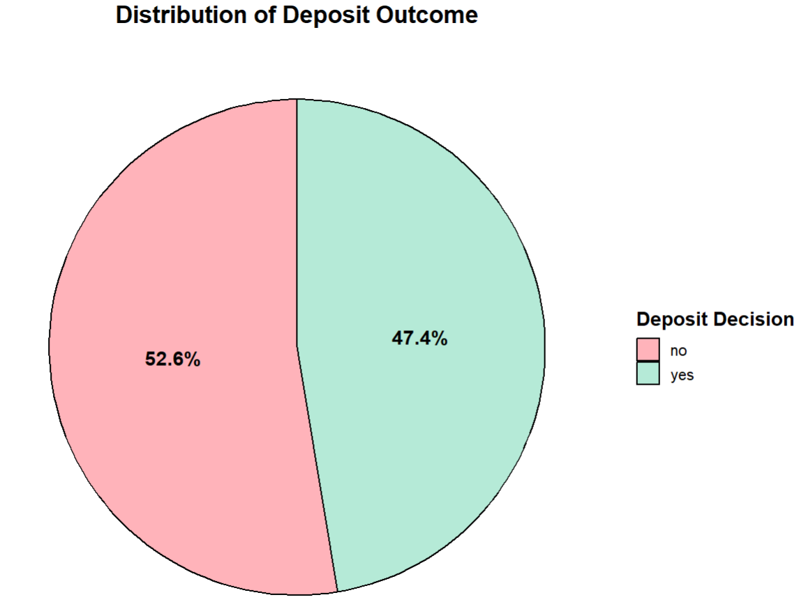
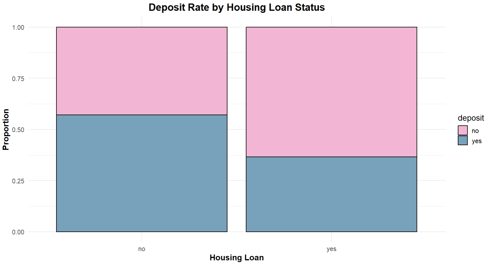
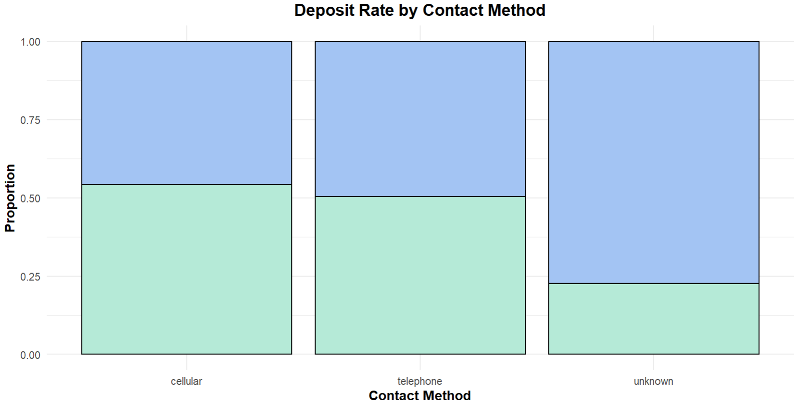
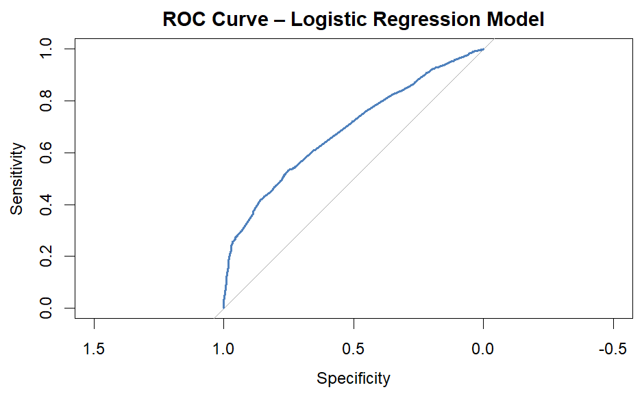
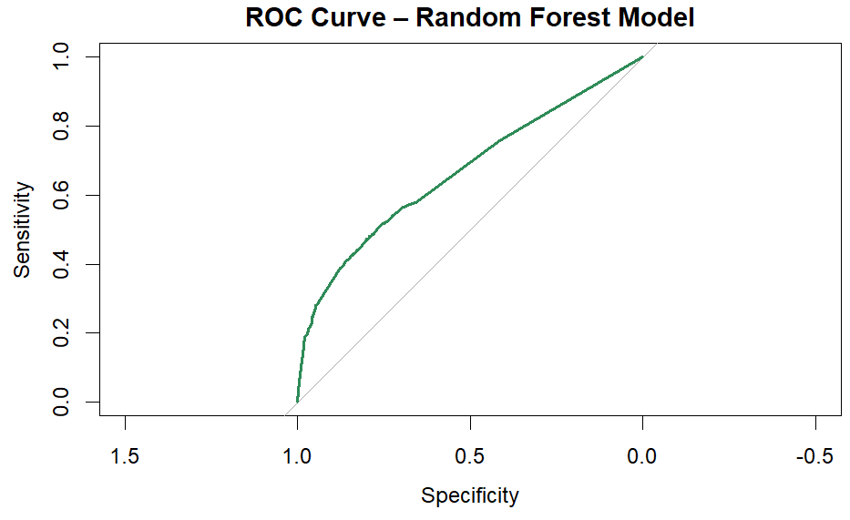

# Bank Deposit Prediction | Machine Learning in R

## Project Overview
This project focuses on predicting whether a bank customer will subscribe to a term deposit using Machine Learning techniques in R.

The analysis explores customer demographics, financial characteristics, and marketing campaign history to identify patterns influencing deposit subscriptions.

## Dataset
The dataset contains 11,162 customer records and 17 original variables, including demographic, financial, and campaign-related information.

The target variable, **deposit**, indicates whether a customer subscribed to a term deposit (`yes` / `no`).

## Methodology

### 1. Data Preprocessing & Feature Engineering
- Checked data structure and missing values
- Converted categorical variables into factors
- Created new variables such as:
  - age_group
  - balance_positive
  - was_contacted_before
  - num_contacts_total
  - duration_group

### 2. Exploratory Data Analysis (EDA)
- Analyzed the distribution of the target variable
- Explored customer age, account balance, and campaign contacts
- Examined relationships between financial and campaign-related variables and deposit subscriptions

### 3. Machine Learning Models
- Built a **Logistic Regression** model
- Built a **Random Forest** model
- Split the data into training and testing sets
- Evaluated model performance using:
  - Accuracy
  - Confusion Matrix
  - ROC Curve
  - AUC

## Key Insights
- Previous campaign outcomes were strongly associated with deposit subscriptions.
- Customers without housing or personal loans showed higher subscription rates.
- Contact method also appeared to influence deposit subscription behavior.

## Tools & Technologies
- **Language:** R
- **Environment:** RStudio
- **Libraries:** ggplot2, dplyr, caTools, pROC, randomForest, ggbeeswarm
- **Methods:** Data Preprocessing, EDA, Logistic Regression, Random Forest

## Selected Visualizations

### Distribution of Deposit Outcome


### Deposit Rate by Housing Loan Status


### Deposit Rate by Contact Method


### Model Performance – ROC Curves

The ROC curves illustrate the classification performance of both Machine Learning models.

**Logistic Regression**



**Random Forest**



Both models demonstrated moderate classification performance, with similar predictive capabilities.

## How to Run
1. Open the project in RStudio.
2. Make sure the dataset is located in the correct folder.
3. Run the script `ProjectAI.R`.
4. Install missing packages if needed.


## Project File Structure

```text
bank-deposit-prediction/
│
├── README.md
├── ProjectAI.R
│
├── data/
│   └── Bank_data.csv
│
└── assets/
    ├── Distribution-of-Deposit-Outcome.png
    ├── Deposit-Rate-by-Housing-Loan-Status.png
    ├── Deposit-Rate-by-Contact-Method.png
    ├── logistic_regression_roc.png
    └── random_forest_roc.png
```

\## Author


Shir Yitzhak